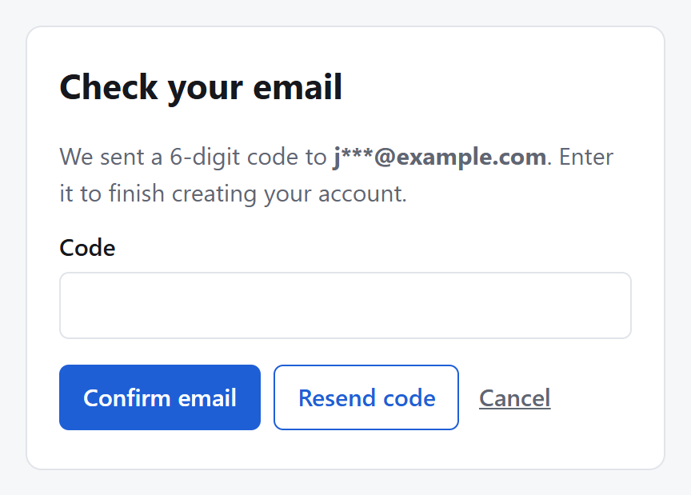
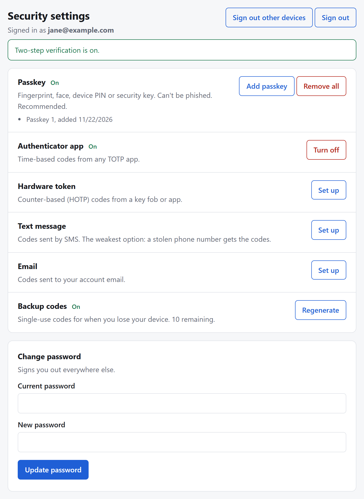
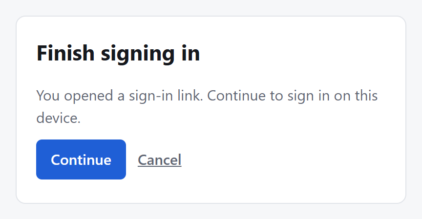
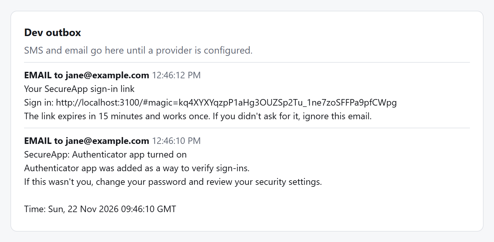

# secure-2fa

A small Node.js login server with password sign-in, email confirmation and two-step verification. It has no npm dependencies: everything (passkeys, TOTP/HOTP, password hashing, encryption, sessions, rate limiting) is built on `node:crypto` and `node:http`.

Supported second factors, strongest first:

| Method | Notes |
|---|---|
| Passkey | WebAuthn. Fingerprint, face, device PIN or a security key. The only option that can't be phished. |
| Authenticator app (TOTP) | RFC 6238, 30-second codes. Works with Google Authenticator, Microsoft Authenticator, Authy, 1Password, etc. |
| Hardware token (HOTP) | RFC 4226, counter-based codes. Look-ahead window of 10 for counter drift. |
| Email | 6-digit code via SendGrid. |
| Text message | 6-digit code via Twilio. The weakest option, because of SIM-swap attacks. |
| Backup codes | 10 single-use codes, issued automatically when the first method is turned on. |

Users can also sign in with an emailed one-time link. If two-step verification is on, it is still required after the link.

## Screenshots

| Sign in | Confirm email after sign-up |
|---|---|
|  |  |

**Security settings.** Each method can be set up or turned off. Turning a method off requires the password and signs out other devices.



| Two-step verification | Magic link confirmation |
|---|---|
|  |  |

| Authenticator setup | Backup codes (shown once) |
|---|---|
|  |  |

**Dev outbox.** When no SMS or email provider is configured, messages (codes, links and security alerts) are shown on the page and printed to the console instead of being sent.



## Getting started

Requires Node.js 18 or newer.

```bash
npm start     # http://localhost:3000
npm test      # 34 tests
```

Open http://localhost:3000 (use `localhost`, not `127.0.0.1`: passkeys are tied to the hostname in `BASE_URL`). Create an account, enter the code from the dev outbox, and turn on a method from the settings page.

User data is written to `data/db.json`, and in development the encryption key to `data/secret.key`. Both are ignored by git. Delete the `data/` folder to start over.

## How sign-in works

**Sign-up**
1. `POST /api/register` creates an unconfirmed account and emails a 6-digit code. If the email already has an account, the response is identical, and the owner gets an email saying someone tried to sign up.
2. `POST /api/register/verify` checks the code and signs the user in.

An unconfirmed account can't be used. If someone signs up with an address they don't own, the real owner can still sign up later, which replaces the unconfirmed account.

**Sign-in**
1. `POST /api/login` checks the password. If the account has no second factor, a full session is created.
2. Otherwise the server creates a short-lived *pending* session (10 minutes) and returns the list of enabled methods.
3. For SMS or email, the client calls `POST /api/mfa/challenge/send`. For a passkey, it calls `POST /api/mfa/passkey/options` and passes the result to `navigator.credentials.get()`.
4. `POST /api/mfa/challenge/verify` checks the code or passkey. On success the session ID is replaced and the session is upgraded to full.

**Magic links** put the token after `#` in the URL. Browsers never send that part to the server, and the token is only used when the user clicks *Continue* (`POST /api/magic/verify`). Email security scanners that open links automatically therefore can't use up the token.

## Configuration

All settings are environment variables.

| Variable | Purpose |
|---|---|
| `PORT` | Listen port (default `3000`). |
| `NODE_ENV=production` | Disables the dev outbox, adds `Secure` to cookies, sends HSTS, and requires `APP_SECRET`. |
| `BASE_URL` | Public URL, e.g. `https://example.com`. Used in magic links, and its hostname is the passkey relying party ID. |
| `APP_SECRET` | 64 hex characters. Master key for encrypting secrets and hashing codes. **Required in production.** In development, a key is generated in `data/secret.key` if unset. |
| `APP_NAME` | Name shown in authenticator apps, passkey prompts and messages (default `SecureApp`). |
| `TRUST_PROXY=1` | Use the first `X-Forwarded-For` address as the client IP. Only set this behind a reverse proxy you control. |
| `BREACH_CHECK=0` | Turn off the leaked-password check (on by default). |
| `TWILIO_ACCOUNT_SID`, `TWILIO_AUTH_TOKEN`, `TWILIO_FROM` | Send SMS through Twilio. |
| `SENDGRID_API_KEY`, `EMAIL_FROM` | Send email through SendGrid. |

Generate `APP_SECRET` with:

```bash
node -e "console.log(require('crypto').randomBytes(32).toString('hex'))"
```

Keep `APP_SECRET` out of the server's data directory and backups, for example in your host's secret manager. Changing it makes existing TOTP/HOTP secrets and backup codes unreadable.

In production, sending SMS or email fails with `503` if the matching provider isn't configured. Run the server behind HTTPS.

## Security design

**Passwords**
- Hashed with scrypt (N=2^15, r=8, p=1) and a random salt.
- 10 to 256 characters, must not contain the email's local part, and must not appear in the [Have I Been Pwned](https://haveibeenpwned.com/Passwords) breach list. Only the first 5 characters of the password's SHA-1 hash are sent. If the service can't be reached, the password is allowed and a warning is logged.
- Logins for unknown emails still run a scrypt check, so response time doesn't reveal whether an account exists.
- 5 wrong passwords lock out **that IP address for that account** for 15 minutes. The real owner on another network isn't affected. Unknown emails lock the same way, so a lockout doesn't reveal whether an account exists.
- 100 wrong passwords for one account within an hour, from any number of IPs, lock the account for 15 minutes and email the owner.
- Changing the password signs out all other sessions.

**Second factors**
- Passkeys: the server checks the challenge (single use, 5-minute expiry), the origin, the relying party ID, the user-presence flag, the signature, and the signature counter (a counter that goes backwards is rejected as a likely cloned key). Supported keys: ES256, Ed25519, RS256.
- TOTP/HOTP secrets are encrypted at rest with AES-256-GCM.
- SMS/email codes, backup codes and magic-link tokens are stored only as HMAC-SHA256 hashes and compared in constant time.
- A TOTP code can't be reused (the last accepted time step is stored).
- SMS/email codes expire after 5 minutes, allow 5 attempts, and have a 30-second resend cooldown.
- 5 wrong codes end the pending sign-in.
- 10 wrong codes on one account within an hour, across all sign-ins and IPs, pause two-step verification for that account and email the owner, since the password is clearly known to someone. The pause starts at 15 minutes and doubles each time, up to 24 hours. Without this limit, an attacker with the password could keep signing in again for fresh guesses.
- Turning a method off or regenerating backup codes requires the password.

**Security alerts**

The account owner is emailed when:
- a sign-in comes from a new IP address
- the password changes
- a method is turned on or off
- backup codes are regenerated or used
- someone tries to sign up with their address
- either of the lockouts above triggers

**Sessions and requests**
- Sessions are kept server-side. The cookie is `HttpOnly`, `SameSite=Strict`, and `Secure` in production.
- The session ID changes on every privilege change (sign-in, verification, password change).
- Users can sign out all other devices. Turning off a method does this automatically.
- State-changing requests must send `X-Requested-With: fetch` and `Content-Type: application/json`, and must have a matching `Origin` if one is sent.
- Rate limits per IP per minute: 300 requests overall, 30 for sign-in endpoints, 10 for anything that sends an SMS or email.
- Request bodies are capped at 16 KB.
- Headers: a CSP that allows only same-origin scripts, `X-Frame-Options: DENY`, `nosniff`, `Referrer-Policy: no-referrer`, and HSTS in production.

## API

All `POST` requests need the CSRF headers described above. Errors return `{ "error": "..." }` with a 4xx/5xx status. `429` and `423` responses include `retryAfter` (seconds).

| Endpoint | Session | Body, response |
|---|---|---|
| `POST /api/register` | none | `{email, password}`, returns `{verifyRequired}` |
| `POST /api/register/verify` | pending sign-up | `{code}` |
| `POST /api/register/resend` | pending sign-up | |
| `POST /api/login` | none | `{email, password}`, returns `{mfaRequired, methods}` or `{verifyRequired}` |
| `POST /api/logout` | any | |
| `GET /api/me` | any | current user, or pending sign-up / verification info |
| `POST /api/sessions/revoke-others` | full | signs out all other sessions |
| `POST /api/mfa/challenge/send` | pending 2FA | `{method: "sms" \| "email"}` |
| `POST /api/mfa/passkey/options` | pending 2FA | returns `{publicKey}` for `navigator.credentials.get()` |
| `POST /api/mfa/challenge/verify` | pending 2FA | `{method, code}` or `{method: "passkey", credential}` |
| `POST /api/mfa/passkey/setup` | full | returns `{publicKey}` for `navigator.credentials.create()` |
| `POST /api/mfa/passkey/enable` | full | `{credential, name?}` |
| `POST /api/mfa/totp/setup` | full | returns `{secret, otpauthUrl}` |
| `POST /api/mfa/totp/enable` | full | `{code}`, returns `{user, backupCodes?}` |
| `POST /api/mfa/hotp/setup` | full | returns `{secret, counter, otpauthUrl}` |
| `POST /api/mfa/hotp/enable` | full | `{code}` |
| `POST /api/mfa/sms/setup` | full | `{phone}` (E.164, e.g. `+254712345678`) |
| `POST /api/mfa/sms/enable` | full | `{code}` |
| `POST /api/mfa/email/setup` | full | `{}` |
| `POST /api/mfa/email/enable` | full | `{code}` |
| `POST /api/mfa/backup/generate` | full | `{password}`, returns `{backupCodes}` |
| `POST /api/mfa/disable` | full | `{method, password}`; `method: "passkey"` removes all passkeys |
| `POST /api/password` | full | `{currentPassword, newPassword}` |
| `POST /api/magic/request` | none | `{email}`; same response whether or not the account exists |
| `POST /api/magic/verify` | none | `{token}`, returns same as `/api/login` |
| `GET /api/dev/outbox` | none | development only |

`credential` is the browser's `PublicKeyCredential` with its binary fields base64url-encoded; see `public/app.js`.

## Project layout

```
src/server.js            HTTP server, routes, sessions, lockouts, alerts
src/lib/webauthn.js      Passkey registration and sign-in verification (CBOR, COSE keys)
src/lib/otp.js           TOTP, HOTP and Base32
src/lib/crypto-utils.js  scrypt, AES-GCM, HMAC token hashing, backup codes, breach check
src/lib/notify.js        Twilio / SendGrid delivery and the dev outbox
src/lib/store.js         JSON file storage
public/                  Browser UI (plain HTML, CSS and JS)
public/vendor/           qrcode.js 1.0.0 (MIT), served locally
test/                    node:test suites and a software passkey authenticator
docs/screenshots/        Images used in this README
```

## Tests

`npm test` runs the built-in `node:test` runner. The tests cover:

- TOTP and HOTP against the RFC 4226 and RFC 6238 test vectors, plus Base32 round-trips
- Passkeys (ES256 and Ed25519) through a software authenticator: registration, sign-in, and rejection of wrong challenge, origin, relying party, a tampered signature, a replayed response and a cloned key
- Email confirmation: required before use, limited guesses, resend, sign-up that doesn't reveal existing accounts, replacing unconfirmed sign-ups
- Setup, sign-in and failure paths for each method
- Backup codes: single use, and old codes stop working after regenerating
- Magic links: opening the page doesn't use the token, single use, and still require two-step verification when it's on
- Lockouts: a lockout by IP doesn't affect the owner elsewhere, unknown emails lock the same way, and wrong codes count per account across sign-ins
- Security alerts, signing out other sessions, password change, leaked-password rejection
- CSRF checks, malformed headers, the rate limit on sending codes, and refusing to start in production without `APP_SECRET`
- Secrets encrypted at rest, and no codes stored in plain text

The UI flows, including passkeys (using Chrome's virtual authenticator), were also checked in a real browser.

## Limitations

- **Phishing:** code-based methods (TOTP, HOTP, SMS, email) can still be relayed by a fake login page in real time. Only passkeys prevent that, so encourage users to add one.
- **SMS:** an attacker who takes over the phone number (SIM swap) receives the codes. This can't be fixed in code, so the UI marks SMS as the weakest option.
- **Account lockout:** the per-account lock still lets an attacker who controls many IP addresses lock a target out for 15 minutes at a time. Adding a CAPTCHA after several failures would remove this.
- **Scaling:** sessions are stored in memory, so restarting the server signs everyone out, and you can't run more than one instance without a shared session store. `store.js` keeps all users in one JSON file and rewrites it on every change. Replace it with a real database before you have real traffic.
- **Missing features:** there is no password reset by email, and passkeys work only as a second factor, not for passwordless sign-in.
- **Not audited:** the code has not had an independent security audit or penetration test. Get one before protecting real users.

## License

MIT
