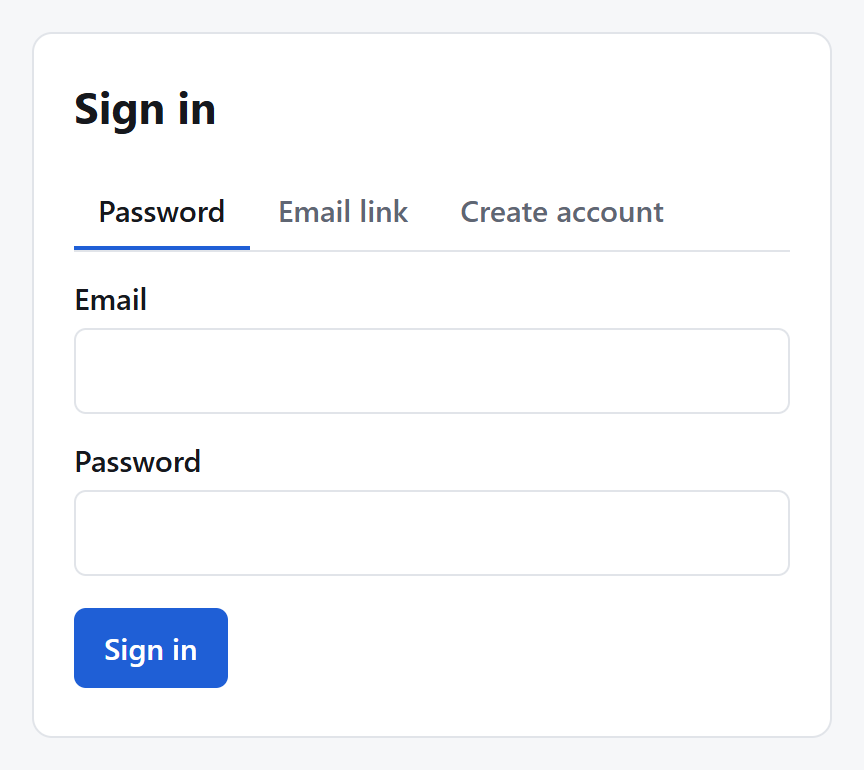
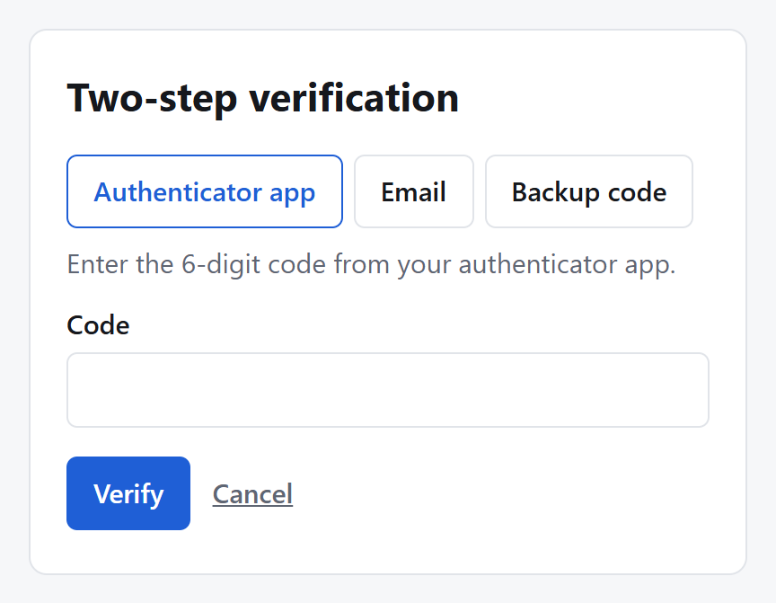
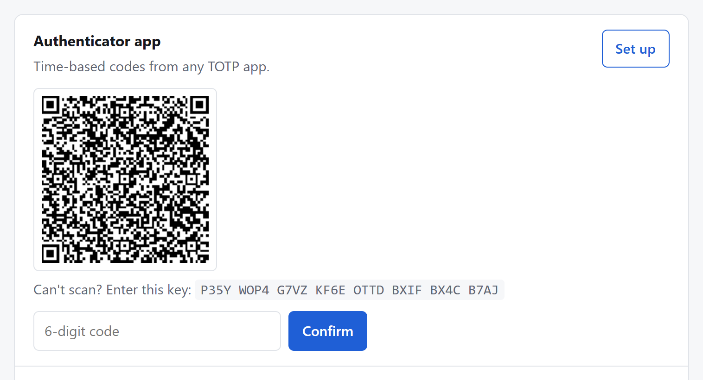
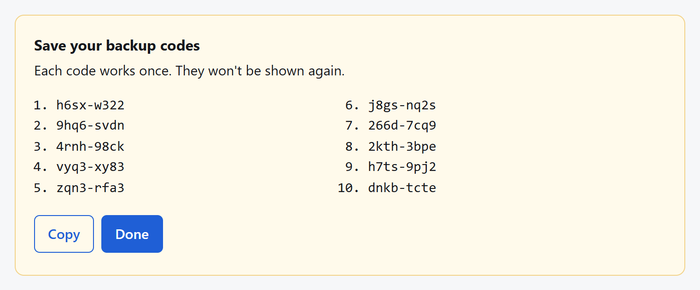

# secure-2fa

A small Node.js login server with password sign-in and two-step verification. It has no npm dependencies: everything (TOTP/HOTP, password hashing, encryption, sessions, rate limiting) is built on `node:crypto` and `node:http`.

Supported second factors:

| Method | Notes |
|---|---|
| Authenticator app (TOTP) | RFC 6238, 30-second codes. Works with Google Authenticator, Microsoft Authenticator, Authy, 1Password, etc. |
| Hardware token (HOTP) | RFC 4226, counter-based codes. Look-ahead window of 10 for counter drift. |
| Text message | 6-digit code via Twilio. |
| Email | 6-digit code via SendGrid. |
| Backup codes | 10 single-use codes, issued automatically when the first method is turned on. |

Users can also sign in with an emailed one-time link. If two-step verification is on, it is still required after the link.

## Screenshots

| Sign in | Two-step verification |
|---|---|
|  |  |

**Security settings.** Each method can be set up or turned off. Turning a method off requires the password.


| Authenticator setup | Backup codes (shown once) |
|---|---|
|  |  |

**Dev outbox.** When no SMS or email provider is configured, messages are shown on the page and printed to the console instead of being sent.


## Getting started

Requires Node.js 18 or newer.

```bash
npm start     # http://localhost:3000
npm test      # 21 tests
```

Open http://localhost:3000, create an account and turn on a method from the settings page. In development, SMS and email codes appear in the dev outbox at the bottom of the page.

User data is written to `data/db.json`, and the encryption key to `data/secret.key`. Both are ignored by git. Delete the `data/` folder to start over.

## How sign-in works

1. `POST /api/login` checks the password. If the account has no second factor, a full session is created.
2. Otherwise the server creates a short-lived *pending* session (10 minutes) and returns the list of enabled methods.
3. For SMS or email, the client calls `POST /api/mfa/challenge/send` to get a code.
4. `POST /api/mfa/challenge/verify` checks the code. On success the session ID is replaced and the session is upgraded to full.
5. After 5 wrong codes the pending session is destroyed and the user must start again.

Magic links follow the same path: the link replaces step 1, and steps 2–5 still apply if a second factor is enabled.

## Configuration

All settings are environment variables.

| Variable | Purpose |
|---|---|
| `PORT` | Listen port (default `3000`). |
| `NODE_ENV=production` | Disables the dev outbox, adds `Secure` to cookies and sends HSTS. |
| `BASE_URL` | Public URL, used in magic links, e.g. `https://example.com`. |
| `APP_SECRET` | 64 hex characters. Master key for encrypting secrets and hashing codes. If unset, a key is generated in `data/secret.key`. |
| `APP_NAME` | Name shown in authenticator apps and messages (default `SecureApp`). |
| `TRUST_PROXY=1` | Use the first `X-Forwarded-For` address as the client IP. Only set this behind a reverse proxy you control. |
| `TWILIO_ACCOUNT_SID`, `TWILIO_AUTH_TOKEN`, `TWILIO_FROM` | Send SMS through Twilio. |
| `SENDGRID_API_KEY`, `EMAIL_FROM` | Send email through SendGrid. |

Generate `APP_SECRET` with:

```bash
node -e "console.log(require('crypto').randomBytes(32).toString('hex'))"
```

In production, SMS or email requests fail with `503` if the matching provider isn't configured. Run the server behind HTTPS.

## Security design

**Passwords**
- Hashed with scrypt (N=2^15, r=8, p=1) and a random salt.
- 10–256 characters, must not contain the email's local part.
- Logins for unknown emails still run a scrypt check, so response time doesn't reveal whether an account exists.
- 5 wrong passwords lock the account for 15 minutes.
- Changing the password signs out all other sessions.

**Second factors**
- TOTP/HOTP secrets are encrypted at rest with AES-256-GCM.
- SMS/email codes, backup codes and magic-link tokens are stored only as HMAC-SHA256 hashes.
- Codes are compared in constant time.
- A TOTP code can't be reused (the last accepted time step is stored).
- SMS/email codes expire after 5 minutes, allow 5 attempts, and have a 30-second resend cooldown.
- Turning a method off or regenerating backup codes requires the password.

**Sessions and requests**
- Sessions are kept server-side. The cookie is `HttpOnly`, `SameSite=Strict`, and `Secure` in production.
- The session ID changes on every privilege change (login, verification, password change).
- State-changing requests must send `X-Requested-With: fetch` and `Content-Type: application/json`, and must have a matching `Origin` if one is sent.
- Rate limits per IP per minute: 300 requests overall, 30 for sign-in endpoints, 10 for anything that sends an SMS or email.
- Request bodies are capped at 10 KB.
- Headers: a CSP that allows only same-origin scripts, `X-Frame-Options: DENY`, `nosniff`, `Referrer-Policy: no-referrer`, and HSTS in production.

## API

All `POST` requests need the CSRF headers described above. Errors return `{ "error": "..." }` with a 4xx/5xx status.

| Endpoint | Session | Body / response |
|---|---|---|
| `POST /api/register` | none | `{email, password}` |
| `POST /api/login` | none | `{email, password}` → `{mfaRequired, methods}` |
| `POST /api/logout` | any | |
| `GET /api/me` | any | current user, or pending verification info |
| `POST /api/mfa/challenge/send` | pending | `{method: "sms" \| "email"}` |
| `POST /api/mfa/challenge/verify` | pending | `{method, code}` |
| `POST /api/mfa/totp/setup` | full | → `{secret, otpauthUrl}` |
| `POST /api/mfa/totp/enable` | full | `{code}` → `{user, backupCodes?}` |
| `POST /api/mfa/hotp/setup` | full | → `{secret, counter, otpauthUrl}` |
| `POST /api/mfa/hotp/enable` | full | `{code}` |
| `POST /api/mfa/sms/setup` | full | `{phone}` (E.164, e.g. `+254712345678`) |
| `POST /api/mfa/sms/enable` | full | `{code}` |
| `POST /api/mfa/email/setup` | full | `{}` |
| `POST /api/mfa/email/enable` | full | `{code}` |
| `POST /api/mfa/backup/generate` | full | `{password}` → `{backupCodes}` |
| `POST /api/mfa/disable` | full | `{method, password}` |
| `POST /api/password` | full | `{currentPassword, newPassword}` |
| `POST /api/magic/request` | none | `{email}`; same response whether or not the account exists |
| `GET /api/magic/verify?token=` | none | redirects to `/` |
| `GET /api/dev/outbox` | none | development only |

## Project layout

```
src/server.js            HTTP server, routes, sessions, rate limiting
src/lib/otp.js           TOTP, HOTP and Base32
src/lib/crypto-utils.js  scrypt, AES-GCM, HMAC token hashing, backup codes
src/lib/notify.js        Twilio / SendGrid delivery and the dev outbox
src/lib/store.js         JSON file storage
public/                  Browser UI (plain HTML, CSS and JS)
public/vendor/           qrcode.js 1.0.0 (MIT), served locally
test/                    node:test suites: RFC test vectors and end-to-end flows
docs/screenshots/        Images used in this README
```

## Tests

`npm test` runs the built-in `node:test` runner. The tests cover:

- TOTP and HOTP against the RFC 4226 and RFC 6238 test vectors, plus Base32 round-trips
- Setup, sign-in and failure paths for each method, including resend cooldowns
- Backup codes: single use, and old codes stop working after regenerating
- Magic links: single use, and still require two-step verification when it's on
- Lockout after failed passwords and after failed codes
- Password change and revoking other sessions
- CSRF checks, malformed headers, and the rate limit on sending codes
- Secrets encrypted at rest, and no codes stored in plain text

## Limitations

- Sessions are stored in memory, so restarting the server signs everyone out. You can't run more than one instance without a shared session store.
- `store.js` keeps all users in one JSON file and rewrites it on every change. Replace it with a real database before you have real traffic.
- There is no password reset by email, no email-address verification at sign-up, and no WebAuthn/passkey support.
- SMS is the weakest factor because of SIM-swap attacks. Encourage users to use an authenticator app.

## License

MIT
